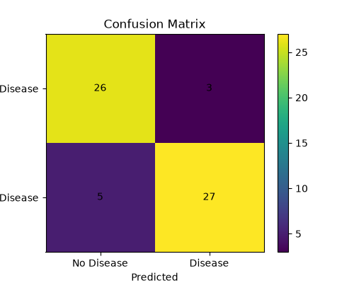
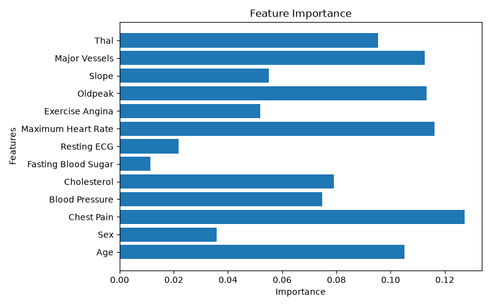

# ❤️ Heart Disease Prediction System

A Machine Learning project that predicts whether a person is likely to have heart disease based on patient health-related features.

The project uses a **Random Forest Classifier** and provides an interactive **Streamlit web application** where users can enter patient information and receive a prediction.

> **Note:** This project is developed for educational purposes and should not be used as a medical diagnosis.
## 🚀 Features

- Heart disease prediction using Machine Learning
- Random Forest classification model
- Handles missing values in the dataset
- Binary classification:
  - `0` = No Heart Disease
  - `1` = Heart Disease
- Interactive Streamlit web interface
- Prediction probability
- Model evaluation using:
  - Accuracy
  - Precision
  - Recall
  - F1-score
  - Confusion Matrix
- Feature importance visualization
## 🛠️ Technologies Used

- Python
- Pandas
- NumPy
- Scikit-learn
- Matplotlib
- Streamlit
- Joblib

### Machine Learning Algorithm

**Random Forest Classifier**

The Random Forest algorithm is used to classify the input data into two categories:

- `0` → No Heart Disease
- `1` → Heart Disease
## 📊 Model Performance

The Random Forest model was evaluated using a test set containing 61 samples.

| Metric | Score |
|---|---:|
| Accuracy | 86.89% |
| Precision | 87% |
| Recall | 87% |
| F1-Score | 87% |

### Confusion Matrix

The model produced the following confusion matrix:

```text
[[26, 3],
 [5, 27]]
## 📁 Project Structure

```text
Disease_Prediction_ML/
│
├── dataset/
│   └── heart.csv
│
├── models/
│   └── heart_disease_model.pkl
│
├── outputs/
│   ├── confusion_matrix.png
│   └── feature_importance.png
│
├── src/
│   └── train.py
│
├── app.py
├── README.md
└── requirements.txt
## ▶️ How to Run the Project

### 1. Clone or download the project

Open the project folder in VS Code.

### 2. Create a virtual environment

```bash
python -m venv venv
venv\Scripts\activate
pip install -r requirements.txt
pip install pandas numpy scikit-learn matplotlib streamlit joblib
python src/train.py
models/heart_disease_model.pkl
streamlit run app.py
## 📈 Outputs

### Confusion Matrix

The confusion matrix shows the number of correctly and incorrectly classified test samples.



### Feature Importance

The feature importance graph shows which patient features contributed more to the Random Forest model's predictions.


## 📚 Dataset

The project uses the `heart.csv` dataset stored inside the `dataset/` folder.

- **Records:** 303
- **Columns:** 14
- **Input features:** 13
- **Target:** 1

### Target Conversion

The original target values are converted into binary classification:

- `0` → No Heart Disease
- `1` → Heart Disease

Original target values `1, 2, 3, 4` are treated as **Heart Disease (1)**.
## ⚠️ Disclaimer

This project is developed for educational and demonstration purposes only.

The predictions generated by this application should **not** be considered medical advice or used as a substitute for professional medical diagnosis.

Always consult a qualified healthcare professional for medical decisions.
